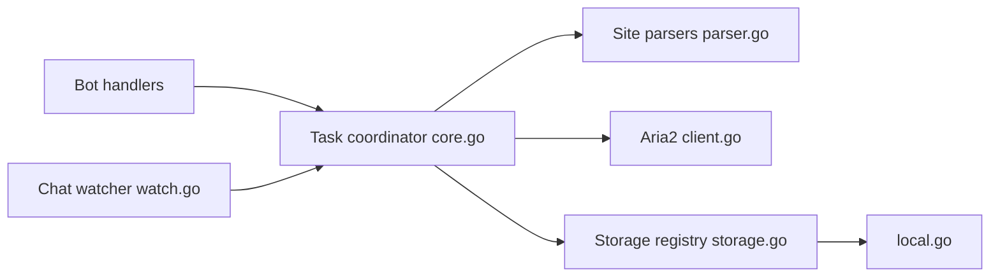

# krau/SaveAny-Bot

> Telegram bot that saves files and media to a chosen storage: disk, S3, WebDAV, Alist…

## The problem
Manually saving Telegram files, including protected ones, to personal storage is tedious.

## What it actually does
A bot receives messages or links and turns them into tasks (download, site parsers in JavaScript, yt-dlp, Aria2), then sends the result to a backend: Alist, S3, WebDAV, local disk, Rclone or Telegram re-upload. Chat monitoring with filters, filing rules, multi-user support, HTTP API.

## How it is wired


## Trying it
```bash
docker run -d --name saveany-bot \
    -v ./config.toml:/app/config.toml \
    -v ./downloads:/app/downloads \
    ghcr.io/krau/saveany-bot:latest
```

## Cost and gotchas
Free, but you need a bot token via @BotFather and a `config.toml` file. Bypassing "restricted content" may violate Telegram's terms.

## What it is not
Not a full Telegram client. The README points to external documentation for detailed configuration.

## Alternatives
No alternative named in the README.

## For you
Worth watching: useful for archiving attachments to an S3, but the AGPL and the bypassing of restrictions limit professional use.
