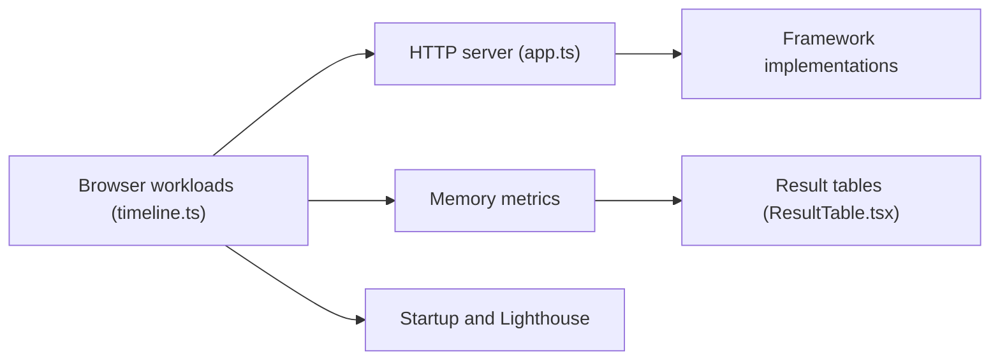

# krausest/js-framework-benchmark

> Performance benchmark of JavaScript frameworks, measuring tables, memory and startup.

## The problem
Objectively comparing the rendering cost of front-end frameworks on the same operations.

## What it actually does
186 implementations (keyed and non-keyed) served by a local server; a WebDriver driver launches Chrome and measures creation, replacement, update, selection, swap, deletion, memory, startup and Lighthouse metrics. Generates a results table. A full run takes about 12 h according to the README.

## How it is wired


## Trying it
```bash
git clone https://github.com/krausest/js-framework-benchmark.git
cd js-framework-benchmark
npm ci && npm run install-local
npm start
npm run bench
npm run results
```

## Cost and gotchas
Free. Installing the 186 packages runs third-party code: the author advises against doing it on your own machine (precompiled binaries provided). Keep the Chrome window visible.

## What it is not
Not a reliable ranking of frameworks for your case: only a table of rows.

## Alternatives
None named in the README.

## For you
Ignore: web front-end measurement, unrelated to data/AI/MLOps.
