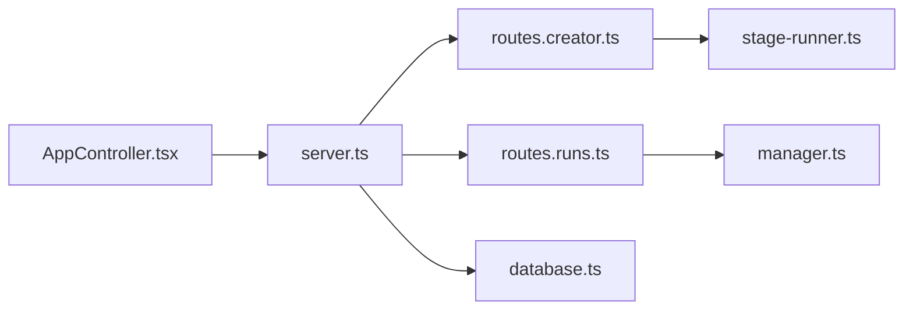

# krillinai/KlicStudio

> Local creation workshop (video, image, text) called OpenCreator, built on the Codex CLI as the agent engine.

## The problem
Chaining video translation, image generation, scripts and voice requires several tools with no shared state.

## What it actually does
Web workspace (React) and desktop application (Electron) sharing a local Fastify daemon. Ten tools: video translation, downloader, thumbnails, images, articles, Xiaohongshu posts, scripts, animation, dubbing, video generation. The conversation and the visual tools share a single state machine; each revision creates a version. The agent engine, Skills and MCP remain those of Codex. The repository was renamed (formerly KrillinAI).

## How it is wired


## Trying it
```bash
git clone https://github.com/krillinai/OpenCreator.git
cd OpenCreator
corepack enable
pnpm install
pnpm web:dev
```

## Cost and gotchas
Node 22+, pnpm 9.15.0, connected Codex CLI. Models and services (GPT Image, Seedance, TTS…) are at your expense. Writes to `$CODEX_HOME`: be careful with global Skills. Auto Clips and Digital Avatar are "under development".

## What it is not
Not an agent engine of its own. The video examples date from the KrillinAI era.

## Alternatives
No alternative named in the README.

## For you
Worth watching: interesting for automated subtitling and dubbing, but it depends on Codex and paid services, and the project is in the middle of a overhaul.
