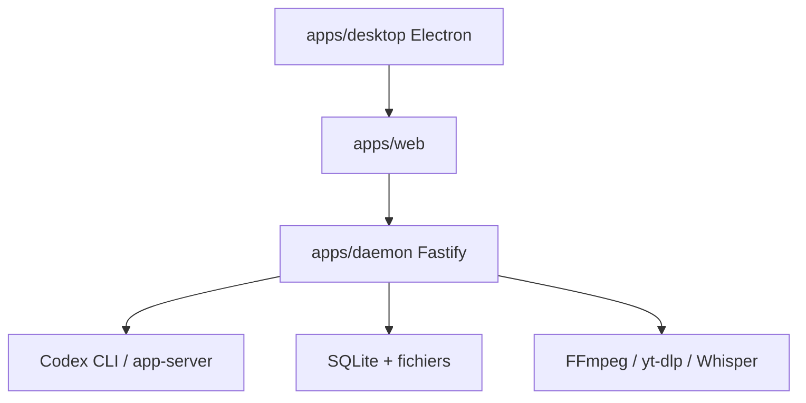

# krillinai/KrillinAI

> OpenCreator (formerly KrillinAI): local workspace for creators, with video translation and a Codex agent.

## The problem
Producing subtitles, dubbing, images, scripts and animations requires chaining many separate tools.

## What it actually does
Web or Electron interface, with a local Fastify runtime that drives Codex CLI as the agent engine. Ten creation tools (video translation, downloader, thumbnails, images, articles, scripts, stick-figure cartoon), skills and MCP via Codex. Local data in SQLite, ffmpeg, yt-dlp and Whisper for media. The provided diagram still describes the old Go-based KrillinAI.

## How it is wired


## Trying it
```bash
git clone https://github.com/krillinai/OpenCreator.git
cd OpenCreator
corepack enable
pnpm install
pnpm web:dev
```

## Cost and gotchas
Node 22, pnpm 9.15 and a valid connection to Codex CLI. Model, TTS and video keys are at your expense. Downloading public videos may raise rights questions.

## What it is not
Not the Go tool described by the diagram: the product was renamed and rewritten. Auto Clips and Digital Avatar are still under development.

## Alternatives
- OpenAI Codex: the agent engine the product relies on.

## For you
Worth watching: relevant for video content, less so for data/AI; the core of the product depends on Codex CLI and paid services.
