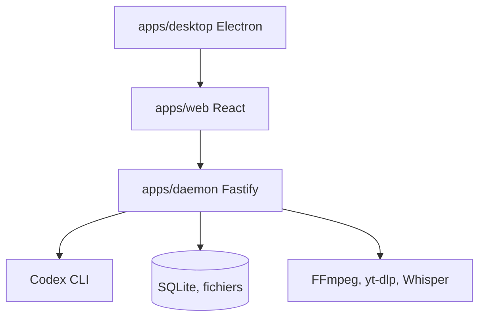

# krillinai/OpenCreator

> Local AI workspace for creators, built on Codex CLI to translate, generate and write.

## The problem
Creators juggle separate tools to translate videos, generate images and voices, and write content.

## What it actually does
Web interface and Electron app on top of a local Fastify runtime that drives Codex CLI as the agent engine. Ten tools: video translation and download, thumbnails, images, articles, scripts, animation, speech synthesis. Skills and MCP go through the Codex configuration. Data stays local (SQLite). The account and subscription go through an online service and Stripe.

## How it is wired


## Trying it
```bash
git clone https://github.com/krillinai/OpenCreator.git
cd OpenCreator
corepack enable
pnpm install
pnpm web:dev
```

## Cost and gotchas
A ChatGPT login or an API key is needed for real tasks, plus keys for the generation services. Node 22+, pnpm 9.15.0 and Codex CLI for the source version. README is truncated after the configuration.

## What it is not
Not an independent agent engine: it reuses Codex. The Auto Clips and Digital Avatar tools are still under development.

## Alternatives
No alternative named in the README.

## For you
Worth watching: interesting for video content production, of little relevance to data or MLOps work.
