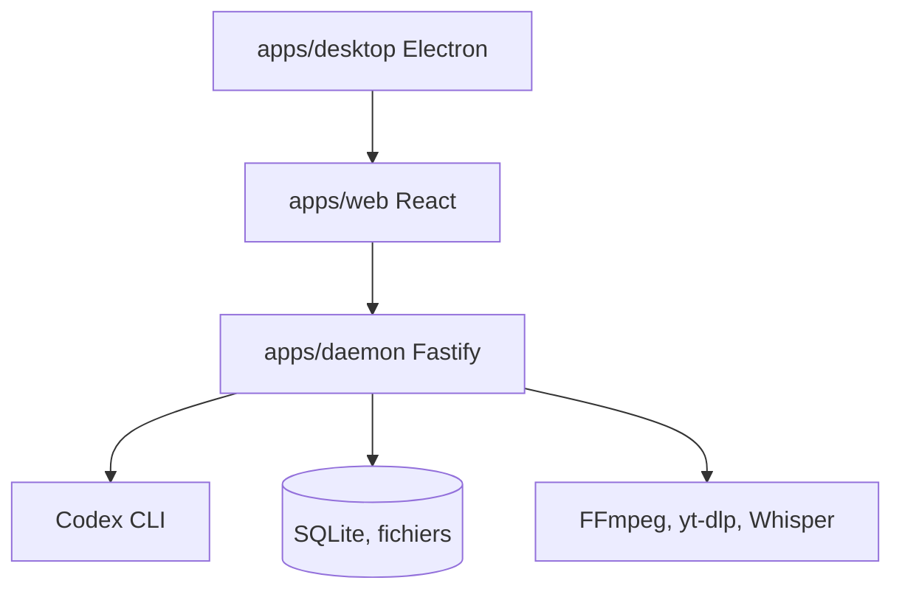

# krillinai/OpenCreator

> Espace de travail IA local pour créateurs, qui s'appuie sur Codex CLI pour traduire, générer et écrire.

## Le problème
Les créateurs jonglent entre outils séparés pour traduire des vidéos, générer des images et voix, et rédiger du contenu.

## Ce que ça fait vraiment
Interface web et application Electron au-dessus d'un runtime local Fastify qui pilote Codex CLI comme moteur d'agent. Dix outils : traduction et téléchargement de vidéo, miniatures, images, articles, scripts, animation, synthèse vocale. Skills et MCP passent par la configuration Codex. Données en local (SQLite). Le compte et l'abonnement passent par un service en ligne et Stripe.

## Comment c'est branché


## Essayer
```bash
git clone https://github.com/krillinai/OpenCreator.git
cd OpenCreator
corepack enable
pnpm install
pnpm web:dev
```

## Coût et pièges
Il faut une connexion ChatGPT ou une clé d'API pour les tâches réelles, et des clés pour les services de génération. Node 22+, pnpm 9.15.0 et Codex CLI pour la version source. README tronqué après la configuration.

## Ce que ce n'est pas
Pas un moteur d'agent indépendant : il réutilise Codex. Les outils Auto Clips et Digital Avatar sont encore en développement.

## Alternatives
Aucune alternative nommée dans le README.

## Pour toi
À surveiller : intéressant pour la production de contenu vidéo, peu pertinent pour un travail data ou MLOps.

