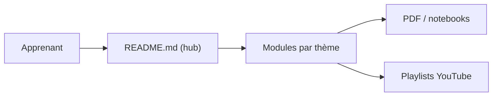

# krishnaik06/The-Grand-Complete-Data-Science-Materials

> Learning path of YouTube videos and materials for learning data science, from Python to MLOps, by Krish Naik.

## The problem
A beginner doesn't know in what order to learn Python, statistics, SQL, machine learning and deployment.

## What it actually does
A README in 14 sections of YouTube playlists (Python, stats, SQL, Git, EDA, ML, deep learning and NLP, Flask, BentoML, MLflow, SageMaker, Docker, generative AI, PySpark). According to the described architecture, the folders also contain PDFs and notebooks. Several entries are marked "coming soon" and the content is in English and Hindi.

## How it is wired

## Trying it
The README is a list of links: no commands.

## Cost and gotchas
Free, but the main content is on YouTube and the README points to a training site. Last push in August 2024, and several sections "coming soon".

## What it is not
Not a structured course with graded exercises: it is an index of videos. The GPL-2.0 license applies to the repository, not to the videos.

## Alternatives
No alternative named in the README.

## For you
Watch: useful as a learning plan for a junior, but of little use to an already experienced profile; dated content.
