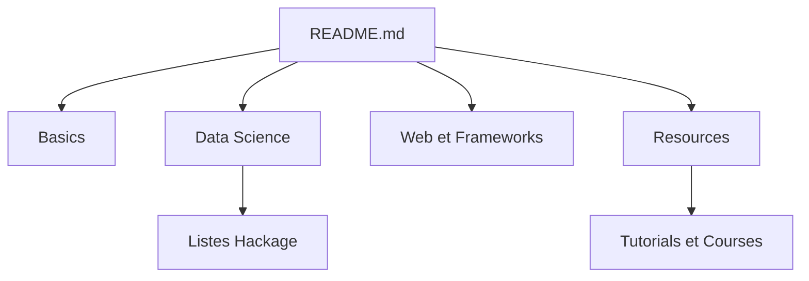

# krispo/awesome-haskell

> List of Haskell links, libraries and resources, organized by theme, for beginners and the curious.

## The problem
Finding useful Haskell tools and libraries means browsing Hackage and several sites with no thematic organization.

## What it actually does
A README structured in sections: basics (GHC, Cabal, Stack, GHCup), data science, databases, web, messaging, tutorials, courses, conferences. Many entries point to collaborative Hackage lists rather than specific projects. On the data side, there is m2cgen, which transpiles classic ML models into Haskell.

## How it is wired
Simplified diagram based on the sheet, no diagram provided.


## Trying it
```bash
# Rien à installer : la liste se lit sur la page GitHub du dépôt.
```

## Cost and gotchas
Free. No license declared in the catalog: reuse of the content is not governed. The last push dates from August 2026, but several links (Haskell Symposium 2015) look old.

## What it is not
Not a learning guide nor a comparison: entries have no quality criterion. No code. The Data Science section is thin.

## Alternatives
No alternative named in the README, apart from Awesome (the parent list) and Hackage.

## For you
Ignore: Haskell is marginal for a data / AI / MLOps profile, and the Data Science section offers almost only pointers.
