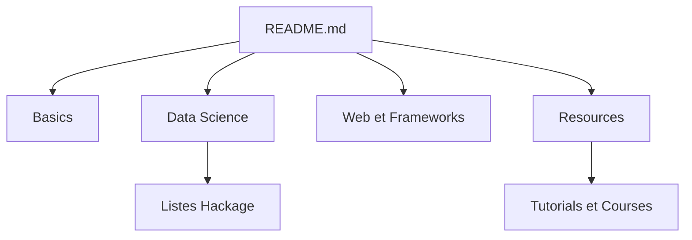

# krispo/awesome-haskell

> Liste de liens, bibliothèques et ressources Haskell, classée par thème, pour les débutants et les curieux.

## Le problème
Trouver les outils et bibliothèques Haskell utiles oblige à parcourir Hackage et plusieurs sites sans classement par thème.

## Ce que ça fait vraiment
Un README structuré en rubriques : bases (GHC, Cabal, Stack, GHCup), data science, bases de données, web, messagerie, tutoriels, cours, conférences. Beaucoup d'entrées renvoient à des listes collaboratives de Hackage plutôt qu'à des projets précis. Côté data, on trouve m2cgen qui transpile des modèles ML classiques en Haskell.

## Comment c'est branché
Schéma simplifié d'après la fiche, sans diagramme fourni.


## Essayer
```bash
# Rien à installer : la liste se lit sur la page GitHub du dépôt.
```

## Coût et pièges
Gratuit. Aucune licence déclarée au catalogue : réutilisation du contenu non encadrée. Le dernier push date d'août 2026, mais plusieurs liens (Haskell Symposium 2015) paraissent anciens.

## Ce que ce n'est pas
Pas un guide d'apprentissage ni un comparatif : les entrées n'ont pas de critère de qualité. Pas de code. La rubrique Data Science est mince.

## Alternatives
Aucune alternative nommée dans le README, hors Awesome (liste mère) et Hackage.

## Pour toi
À ignorer : Haskell est marginal pour un profil data / IA / MLOps, et la rubrique Data Science n'apporte presque que des renvois.

