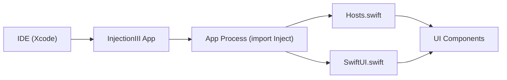

# krzysztofzablocki/Inject

> Swift package that simplifies hot reloading for UIKit, AppKit and SwiftUI apps.

## The problem
Every iOS/macOS interface change forces you to recompile, relaunch and navigate again to the desired screen.

## What it actually does
Thin layer around InjectionIII, which recompiles and injects the code into the running app. For SwiftUI, you add `@ObserveInjection` and `.enableInjection()`. For UIKit/AppKit, you wrap the class in `ViewHost` or `ViewControllerHost`. The code does nothing in non-debug builds.

## How it is wired


## Trying it
```bash
# Package.swift : .package(url: "https://github.com/krzysztofzablocki/Inject.git", from: "1.2.4")
# or Podfile : pod 'InjectHotReload'
```
Then add `-Xlinker -interposable` to Other Linker Flags in Debug and install the InjectionIII app in `/Applications`.

## Cost and gotchas
Free. Per-machine Xcode settings to configure (linker flags, `EMIT_FRONTEND_COMMAND_LINES`). An optional script modifies your source code: review it.

## What it is not
Not a hot reload engine: it depends on InjectionIII. It does not reload a class's initializer.

## Alternatives
No alternative named in the README.

## For you
Ignore: iOS productivity tool with no use for a data/AI/MLOps profile.
