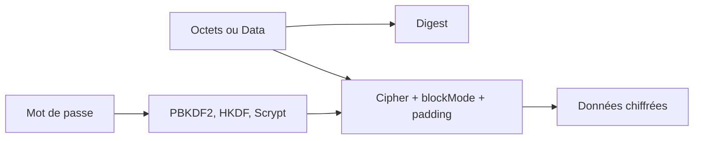

# krzyzanowskim/CryptoSwift

> Cryptographic primitives in pure Swift, for Apple, Linux and Android application developers.

## The problem
Encrypt, hash or derive a key in Swift without linking an external C library.

## What it actually does
It offers hashes (MD5, SHA1, SHA2, SHA3), CRC, ciphers (AES, ChaCha20, Rabbit, Blowfish), RSA, authenticators (HMAC, CMAC, Poly1305), modes (GCM, CCM, CBC…), key derivation (PBKDF2, HKDF, Scrypt) and AEAD. The README recommends AEAD constructions for new protocols.

## How it is wired
Simplified diagram based on the sheet, no diagram provided.



## Trying it
```swift
.package(url: "https://github.com/krzyzanowskim/CryptoSwift.git", from: "1.10.0")
```
```swift
let digest = Data([0x01, 0x02, 0x03]).sha256()
```

## Cost and gotchas
Free. Swift 5.6 minimum. A license is present but not identified by GitHub: to be checked. In Debug, builds are very slow; enable optimization. The README does not mention a security audit.

## What it is not
It is not a Python library nor an audited solution: the author writes "Because I can". The ECB mode, MD5 and SHA-1 are flagged as legacy.

## Alternatives
No alternative named in the README.

## For you
Ignore: reserved for Swift developers, of no use for a data, AI or MLOps profile.
