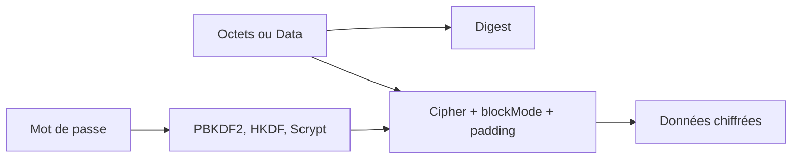

# krzyzanowskim/CryptoSwift

> Primitives cryptographiques en Swift pur, pour développeurs d'applications Apple, Linux et Android.

## Le problème
Chiffrer, hacher ou dériver une clé en Swift sans lier une bibliothèque C externe.

## Ce que ça fait vraiment
Elle offre hachages (MD5, SHA1, SHA2, SHA3), CRC, chiffrements (AES, ChaCha20, Rabbit, Blowfish), RSA, authentificateurs (HMAC, CMAC, Poly1305), modes (GCM, CCM, CBC…), dérivation de clé (PBKDF2, HKDF, Scrypt) et AEAD. Le README recommande les constructions AEAD pour les nouveaux protocoles.

## Comment c'est branché
Schéma simplifié d'après la fiche, sans diagramme fourni.



## Essayer
```swift
.package(url: "https://github.com/krzyzanowskim/CryptoSwift.git", from: "1.10.0")
```
```swift
let digest = Data([0x01, 0x02, 0x03]).sha256()
```

## Coût et pièges
Gratuit. Swift 5.6 minimum. Licence présente mais non identifiée par GitHub : à vérifier. En Debug, les builds sont très lents ; activer l'optimisation. Le README ne parle pas d'audit de sécurité.

## Ce que ce n'est pas
Ce n'est pas une bibliothèque Python ni une solution auditée : l'auteur écrit « Because I can ». Les modes ECB, MD5 et SHA-1 sont signalés comme anciens.

## Alternatives
Aucune alternative nommée dans le README.

## Pour toi
Ignorer : réservé aux développeurs Swift, sans usage pour un profil data, IA ou MLOps.

