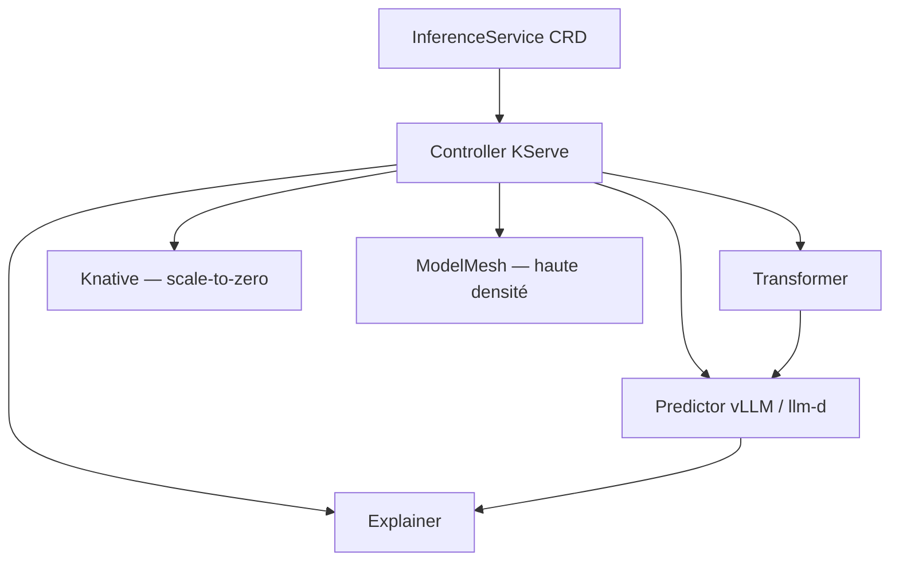

# kserve/kserve

> Kubernetes inference platform that unifies serving of predictive and generative models.

## The problem
Serving a sklearn model and serving an LLM today require two different stacks, two ways of autoscaling, two protocols.
On Kubernetes, everyone ends up rewriting their own Deployment, routing and scale-to-zero.

## What it actually does
A single CRD, the `InferenceService`, describes the model; KServe deploys predictor, transformer and explainer and routes requests between them.
Generative side: vLLM and llm-d backends, OpenAI-compatible protocol, model cache, KV cache offloading to CPU/disk, request-based autoscaling.
Predictive side: TensorFlow, PyTorch, scikit-learn, XGBoost, ONNX, canary deployments, `InferenceGraph` for pipelines and ensembles, scale-to-zero.
Monitoring covers payload logging, outlier, adversarial and drift detection.

## How it is wired


## Trying it
The README gives no installation command: it points to four paths documented on the website (Standard Kubernetes, Knative, ModelMesh, Quick Installation) and to the Kubeflow addon.

```bash
# aucune commande documentée dans le README — voir la documentation du site KServe
```

## Cost and gotchas
Free, but you need a Kubernetes cluster and GPUs for the generative part: the bill is that of the infrastructure.
The lighter "Standard Kubernetes" installation loses canary and request-based autoscaling with scale-to-zero; those two require Knative.

## What it is not
It is not an inference engine: vLLM and llm-d do the work, KServe orchestrates. It cannot be used without Kubernetes, nor on a dev workstation.
And it is not a graduated CNCF project — it is in incubation, which leaves the APIs still free to change.

## Alternatives
- ModelMesh: cited as an optional component for high-density cases / frequently changing models.
- Kubeflow: if you want the complete ML platform rather than just the serving building block.
- vLLM: cited as a backend, sufficient as long as a single model runs on one machine.

## For you
The reference building block if you already serve on Kubernetes and want to stop maintaining two stacks, predictive and generative.
