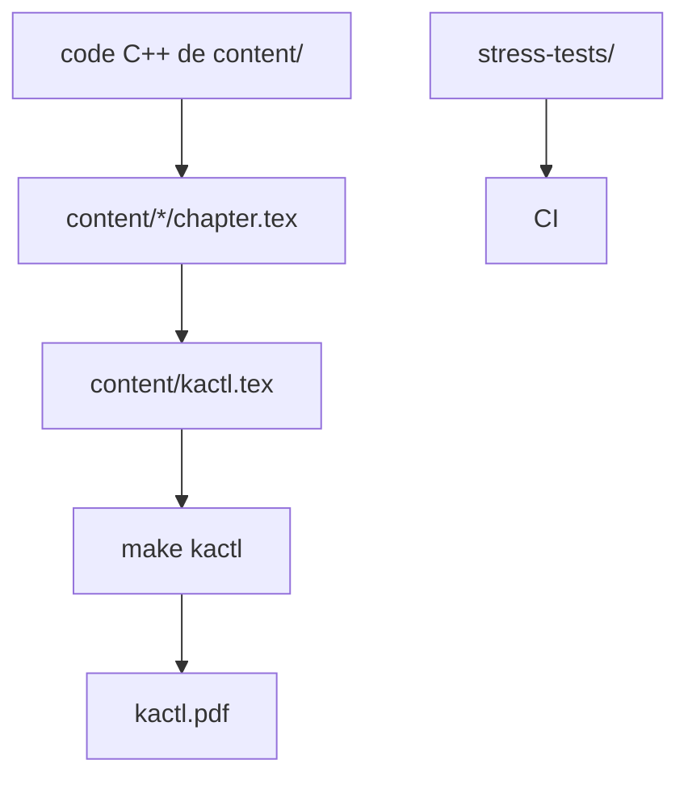

# kth-competitive-programming/kactl

> 25-page cheat sheet of ready-to-copy C++ code for ICPC programming contests.

## The problem
In ICPC contests, algorithms are retyped by hand from limited paper: the code must be short, safe and already tested.

## What it actually does
Collects concise C++ algorithms, with a header (author, date, complexity, test status) and a six-character MD5 hash to check the typing. The `kactl.pdf` document is generated with `make kactl`. Stress tests compare each algorithm against a naive version, run in CI.

## How it is wired
Simplified diagram based on the sheet, no diagram provided.


## Trying it
```bash
make kactl
make fast
make showexcluded
```

## Cost and gotchas
Free. Requires LaTeX and a \*nix machine; Windows is untested. The PDF must stay at 25 pages plus the cover.

## What it is not
Not a library to import: the code is meant to be retyped, hence deliberately not very generic. Very simple algorithms (Dijkstra) or very rare ones are excluded. No licence is declared in the catalogue.

## Alternatives
No alternative named in the README.

## For you
Ignore: reserved for programming contests, no use in data / AI / MLOps, and the licence is not declared.
