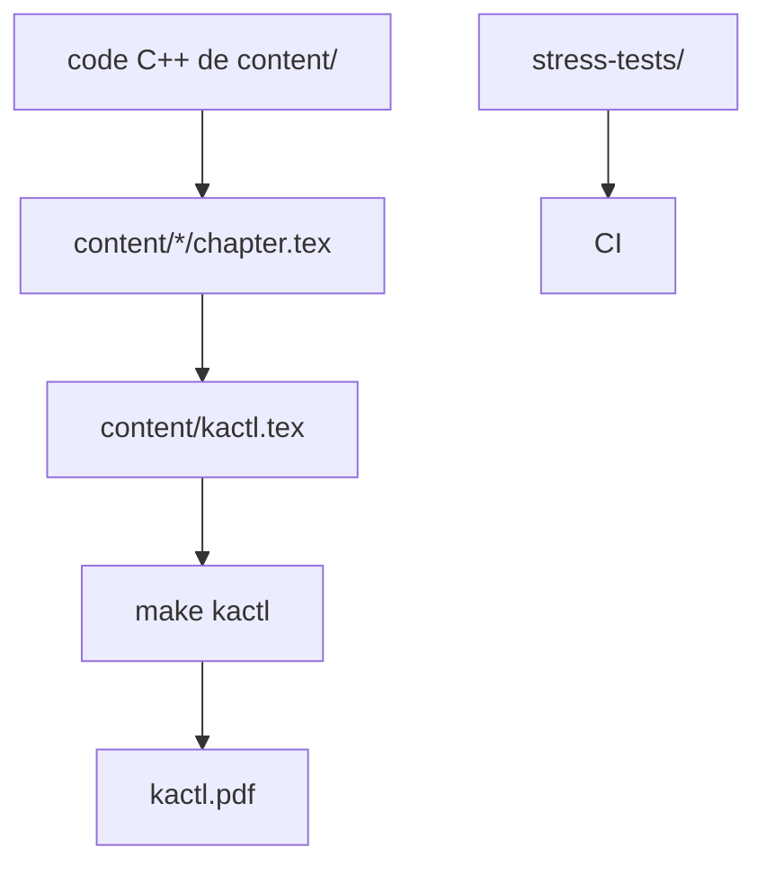

# kth-competitive-programming/kactl

> Aide-mémoire de 25 pages de code C++ prêt à copier, pour les concours de programmation ICPC.

## Le problème
En concours ICPC, on retape les algorithmes à la main sur papier limité : il faut du code court, sûr et déjà testé.

## Ce que ça fait vraiment
Rassemble des algorithmes C++ concis, avec en-tête (auteur, date, complexité, statut de test) et un hachage MD5 à six caractères pour vérifier la saisie. Le document `kactl.pdf` se génère avec `make kactl`. Les tests de charge comparent chaque algorithme à une version naïve, exécutés en CI.

## Comment c'est branché
Schéma simplifié d'après la fiche, sans diagramme fourni.


## Essayer
```bash
make kactl
make fast
make showexcluded
```

## Coût et pièges
Gratuit. Demande LaTeX et une machine \*nix, Windows n'est pas testé. Le PDF doit rester à 25 pages plus la couverture.

## Ce que ce n'est pas
Pas une bibliothèque à importer : le code est fait pour être retapé, donc volontairement peu générique. Les algorithmes très simples (Dijkstra) ou très rares sont exclus. Aucune licence n'est déclarée au catalogue.

## Alternatives
Aucune alternative nommée dans le README.

## Pour toi
À ignorer : réservé aux compétitions de programmation, sans usage en data / IA / MLOps, et la licence n'est pas déclarée.

