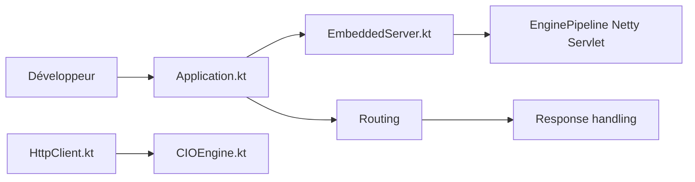

# ktorio/ktor

> Asynchronous Kotlin framework, by JetBrains, for HTTP servers, microservices and clients.

## The problem
Building asynchronous web services and HTTP clients in Kotlin without a heavy framework.

## What it actually does
Server: an `Application` installs features through an interception mechanism, routing handles requests, an engine (Netty, Jetty, servlet, CIO) serves them. Coroutines for async. HTTP client with engines, WebSockets, SSE, sessions, a test host without network.

## How it is wired


## Trying it
```kotlin
dependencies {
    implementation("io.ktor:ktor-server-netty:$ktor_version")
}
```
```bash
./gradlew run
```

## Cost and gotchas
Free. Requires Gradle or Maven and the JDK.

## What it is not
Not an opinionated framework: logging, persistence and injection are left to your choice.

## Alternatives
No alternative named in the README.

## For you
Ignore, unless you have a Kotlin or JVM service to serve a model; in Python, FastAPI is more natural (not from the README).
