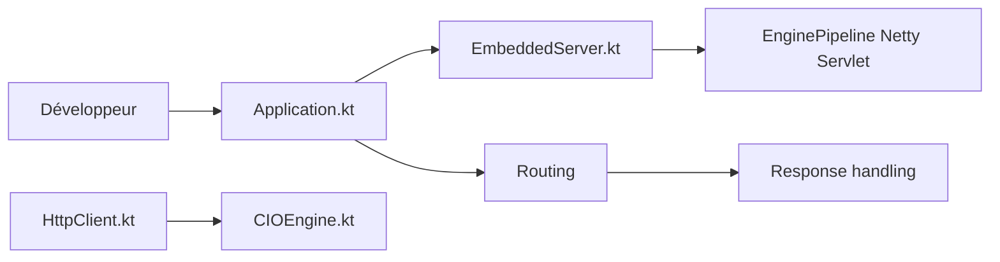

# ktorio/ktor

> Framework Kotlin asynchrone, par JetBrains, pour serveurs HTTP, microservices et clients.

## Le problème
Construire en Kotlin des services web et clients HTTP asynchrones sans framework lourd.

## Ce que ça fait vraiment
Serveur : une `Application` installe des fonctionnalités par un mécanisme d'interception, le routage traite les requêtes, un moteur (Netty, Jetty, servlet, CIO) les sert. Coroutines pour l'asynchrone. Client HTTP avec moteurs, WebSockets, SSE, sessions, hôte de test sans réseau.

## Comment c'est branché


## Essayer
```kotlin
dependencies {
    implementation("io.ktor:ktor-server-netty:$ktor_version")
}
```
```bash
./gradlew run
```

## Coût et pièges
Gratuit. Nécessite Gradle ou Maven et le JDK.

## Ce que ce n'est pas
Pas un framework opinionné : journalisation, persistance et injection restent à ton choix.

## Alternatives
Aucune alternative nommée dans le README.

## Pour toi
Ignorer, sauf service Kotlin ou JVM pour servir un modèle ; en Python, FastAPI est plus naturel (hors README).

