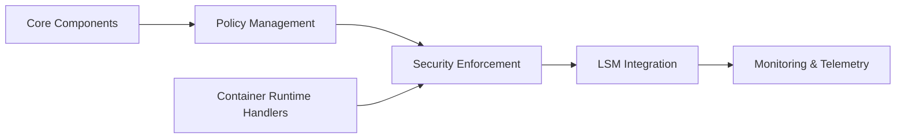

# kubearmor/KubeArmor

> Runtime security system that restricts the processes, files and network of pods and nodes via LSM and eBPF.

## The problem
A compromised container can launch processes or read sensitive files; network rules alone are not enough.

## What it actually does
Applies policies (process allowlist, file access, network) via AppArmor, SELinux or BPF-LSM, and produces alerts with container, pod and namespace identity thanks to eBPF. Deployment on Kubernetes, container or VM. Policies: pod, cluster, host. CNCF Sandbox project.

## How it is wired

## Trying it
No command in the README; it points to a "Getting Started" guide and the `karmor` tool.

## Cost and gotchas
Requires a kernel with compatible LSM/eBPF (support matrix to consult). 412 open issues. The README contains an internal TODO about sub-project governance.

## What it is not
It is not a vulnerability scanner: it applies rules at runtime. It does not protect ML models by itself (the modelarmor repository is separate).

## Alternatives
No alternative named in the README.

## For you
Worth watching: useful if your AI workloads run on shared Kubernetes and runtime security matters; otherwise out of scope.
