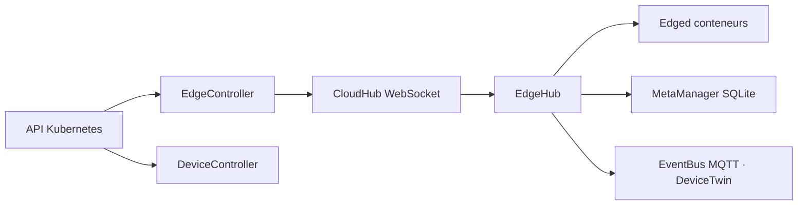

# kubeedge/kubeedge

> Kubernetes extension that brings container and device orchestration to the edge.

## The problem
Edge nodes have an unstable network and few resources: a standard kubelet does not survive there, and MQTT devices have no place in the Kubernetes API.

## What it actually does
Splits into a cloud part and an edge part. On the cloud side, CloudHub (WebSocket server), EdgeController and DeviceController extend Kubernetes to target a specific edge node. On the edge side, EdgeHub talks to the cloud, Edged manages containers, EventBus speaks MQTT, ServiceBus exposes local HTTP, DeviceTwin stores the state of equipment and MetaManager persists metadata in SQLite. Result: nodes keep working offline, even after a restart, and devices are driven through CRDs.

## How it is wired


## Trying it
```bash
# Aucune commande documentée dans le README : il renvoie au « get started » et
# au site kubeedge.io, ainsi qu'au répertoire examples.
```

## Cost and gotchas
Free, **graduated** CNCF project, with a third-party security audit from July 2022 and a published threat analysis paper. The real point of attention is compatibility: the README table specifies precisely which KubeEdge version goes with which Kubernetes version (1.27 to 1.32), and stepping outside this grid breaks APIs.

## What it is not
It is not a standalone Kubernetes distribution: it relies on an existing cluster. It is not an MQTT broker — it uses one (mosquitto). It is not an embedded AI tool, even though the README cites model deployment as a use case.

## Alternatives
No alternative named in the README.

## For you
Relevant only if you deploy models on field hardware; otherwise off-topic.
