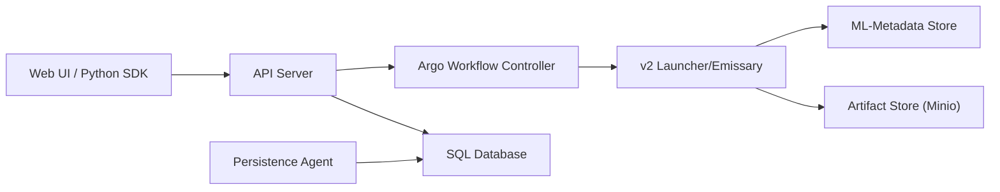

# kubeflow/pipelines

> Machine learning workflow orchestration service on Kubernetes, for MLOps teams.

## The problem
Chaining data preparation, training and evaluation in a repeatable way, with experiment tracking, requires a platform that runs each step in a container.

## What it actually does
The Python SDK describes reusable pipelines; the v2 compiler translates them into Argo workflows. An API server (gRPC and HTTP) stores pipelines and runs in a SQL database. Argo launches one pod per task (Emissary executor). A persistence agent tracks workflows and writes their state; metadata goes through ML-Metadata and artifacts through object storage (Minio). A web interface, a cache service and CRD controllers complete the whole.

## How it is wired


## Trying it
```bash
just
just backend-test
just backend-images
```
These recipes are for developing the project itself; installation goes through the official documentation, not reproduced in the README.

## Cost and gotchas
It needs a Kubernetes cluster, Argo Workflows (v3.7 or v4.1) and MySQL 8. The README warns that KFP 3.0 will no longer accept Argo 3.x: move Argo to 4.x before migrating. The DeepWiki link is AI-generated and may be inaccurate.

## What it is not
It is not a lightweight tool to run on a workstation: it assumes Kubernetes and several components to operate. Nor is it a complete MLOps platform: model tracking and serving belong to other building blocks of the Kubeflow project.

## Alternatives
No alternative cited in the README (Argo Workflows is the underlying engine there, not a competitor).

## For you
Adopt it if your team already has Kubernetes and wants an established ML orchestrator (2018, activity in September 2026); without a cluster, the operating cost outweighs the benefit.
