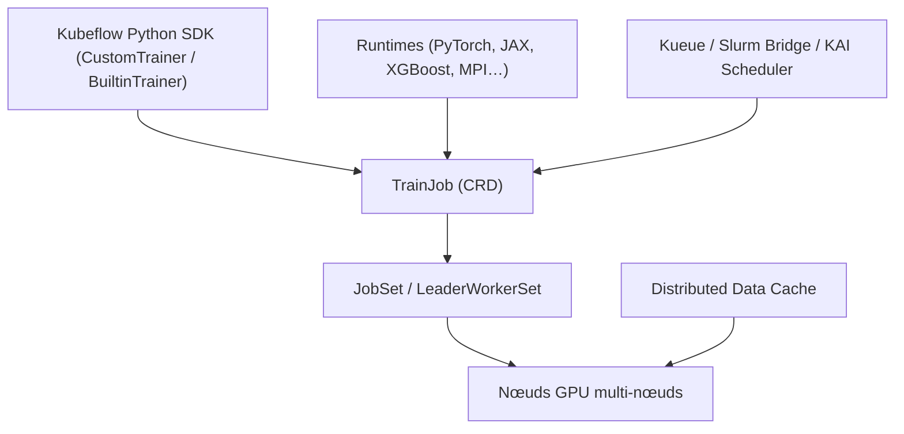

# kubeflow/trainer

> A Kubernetes-native platform for distributed training and LLM fine-tuning.

## The problem
Launching a multi-node multi-GPU training on Kubernetes means assembling yourself the orchestration, the MPI communication and the streaming of data to the GPUs.

## What it actually does
Exposes two APIs — `TrainJob` and `Runtimes` — for PyTorch, MLX, HuggingFace, DeepSpeed, Megatron-LM, JAX and XGBoost. Brings MPI to Kubernetes for fast synchronization between GPU nodes. Reuses the native JobSet and LeaderWorkerSet building blocks rather than reinventing orchestration. Provides a distributed data cache that streams zero-copy directly to the GPU nodes. Integrates with Kueue (topology-aware scheduling, multi-cluster dispatch), the Slurm Bridge (hybrid Kubernetes/Slurm clusters) and KAI Scheduler. A Kubeflow Python SDK enables local PyTorch development and execution.

## How it is wired

## Trying it
No command documented: the README points to the official Kubeflow Trainer documentation for installation and getting started.

## Cost and gotchas
Free, but assumes a Kubernetes cluster and GPUs. The project explicitly declares itself **alpha status, with APIs that may change**. If you are on Training Operator V1, migration is a separate undertaking: the V1 code remains maintained on the `release-1.9` branch.

## What it is not
It is not a training framework: it orchestrates PyTorch, JAX and the others, it does not replace them. Nor is it Kubeflow Pipelines. And it is not V1 of the Training Operator, despite the name.

## Alternatives
- Kubeflow Training Operator V1, to stay on a stable API while waiting for it to leave alpha.
- KubeRay, if your distributed runtime is Ray rather than MPI/PyTorch.

## For you
The natural candidate if you are building an internal training platform on Kubernetes — accepting the alpha.
