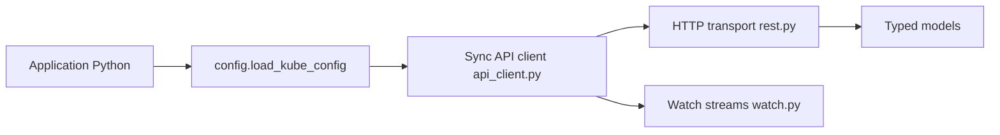

# kubernetes-client/python

> Official Python client for the Kubernetes API, synchronous and asynchronous.

## The problem
Driving a cluster from Python code without writing the REST calls yourself.

## What it actually does
Loads a configuration (`load_kube_config`), exposes typed API groups (CoreV1Api…), supports asyncio, watches, informers, the dynamic client and creating resources from YAML. The `stream` module handles exec/attach.

## How it is wired


## Trying it
```bash
pip install kubernetes
python -m examples.example1
```

## Cost and gotchas
Free, but you need a cluster and a kubeconfig. Versioning follows Kubernetes (vY.Z.P). Exec/attach pitfall: use `stream` and recreate the client afterwards.

## What it is not
Not a deployment tool: it calls the API, nothing more.

## Alternatives
No alternative named in the README.

## For you
Adopt it as soon as you automate MLOps on Kubernetes in Python: official client, recent activity, Apache-2.0 license.
