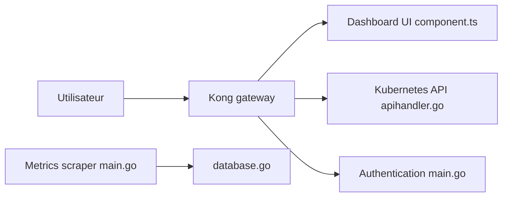

# kubernetes-retired/dashboard

> General-purpose web interface for administering a Kubernetes cluster, now archived in favor of Headlamp.

## The problem
See and troubleshoot a cluster's workloads without doing everything in `kubectl`.

## What it actually does
Web interface: workloads, cluster resources, discovery, config and storage, logs, shell into a container, resource creation, CRD views with raw YAML/JSON. Since 7.0.0: Helm-only installation, with a Kong gateway and several containers (UI, API, authentication, metrics scraper).

## How it is wired


## Trying it
```bash
helm repo add kubernetes-dashboard https://kubernetes.github.io/dashboard/
helm upgrade --install kubernetes-dashboard kubernetes-dashboard/kubernetes-dashboard --create-namespace --namespace kubernetes-dashboard
```

## Cost and gotchas
Free, but no longer maintained: expect no security fixes. Exposing a cluster admin UI requires careful access control.

## What it is not
Not maintained, not an observability tool. The README points to Headlamp.

## Alternatives
- Headlamp: cited by the README, taken over under sig-ui, hence maintained.

## For you
Ignore: archived in January 2026, the README itself steers toward Headlamp; do not build an MLOps platform on it.
