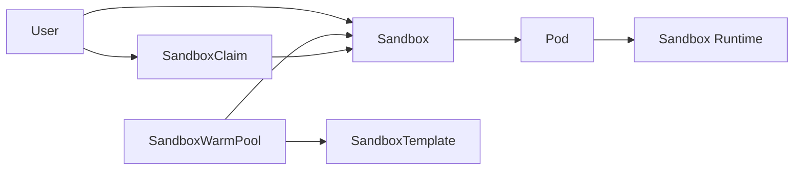

# kubernetes-sigs/agent-sandbox

> Kubernetes CRD for isolated, persistent sandboxes with a stable identity, designed for agents.

## The problem
An agent runtime wants a single, durable container reachable by a stable name.
Deployments and StatefulSets only answer this by being bent out of shape, with no hibernation or resume.

## What it actually does
The `Sandbox` CRD manages a single pod with a stable network identity, persistent storage, pause and resume.
The extensions add `SandboxTemplate` (reusable templates), `SandboxClaim` and `SandboxWarmPool`.
The pre-warmed pool reduces the delay to obtain a sandbox, useful in a training or evaluation loop.
Strong isolation is delegated to third-party runtimes via `RuntimeClass`: gVisor, Kata Containers.

## How it is wired


## Trying it
```sh
kubectl apply -f https://github.com/kubernetes-sigs/agent-sandbox/releases/latest/download/sandbox-with-extensions.yaml
pip install k8s-agent-sandbox
```

## Cost and gotchas
You need a Kubernetes cluster and, for real isolation, to install gVisor or Kata separately.
Deleting the CRDs cascades to delete all associated resources, in all namespaces.

## What it is not
Not an isolation engine: it orchestrates runtimes that do the isolating.
Not a managed service nor a turnkey sandbox offering.
The HTTP router is optional and deployed separately.

## Alternatives
StatefulSet of size 1 with Service and PVC: the approximation the project says it wants to replace.

## For you
The right building block if you must run LLM-generated code on a cluster; otherwise wait for maturity.
