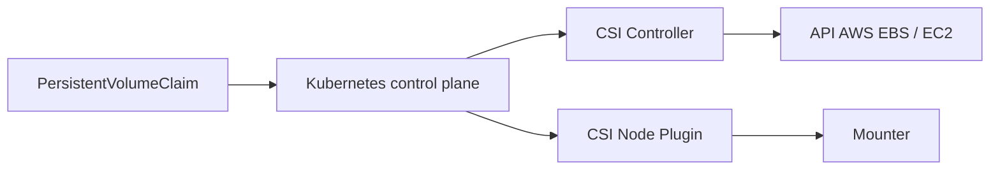

# kubernetes-sigs/aws-ebs-csi-driver

> CSI driver that provisions and manages AWS EBS volumes and snapshots for Kubernetes.

## The problem
Pods need persistent EBS volumes without creating and attaching them by hand.

## What it actually does
Implements the CSI spec (v1.9.0): static and dynamic provisioning via StorageClass, raw block volumes, snapshots, resizing, type/IOPS/throughput modification via `VolumeAttributesClass`, node-local volumes. Components: controller, node, identity; it calls the EC2 APIs and the Linux/Windows mounter. Monthly releases, Helm chart.

## How it is wired

## Trying it
The README contains no installation command; it points to the "Driver Installation" doc and the Helm chart (registry.k8s.io/provider-aws/charts/aws-ebs-csi-driver).

## Cost and gotchas
EBS volumes are billed by AWS; IAM permissions required; compatible with supported Kubernetes versions, including extended EKS.

## What it is not
Not shared multi-node storage (EBS is attached to one zone/instance). Works only with AWS.

## Alternatives
The README names no alternative.

## For you
Adopt if your ML workloads run on EKS and need persistent disks: it is the standard building block on the AWS side.
