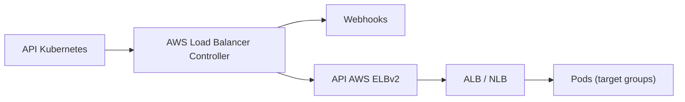

# kubernetes-sigs/aws-load-balancer-controller

> Kubernetes controller that creates AWS load balancers for Ingresses, Services and Gateways.

## The problem
Exposing Kubernetes applications on AWS requires creating and synchronizing load balancers by hand.

## What it actually does
The README is very short. It states that the controller satisfies Ingresses with Application Load Balancers, Services with Network Load Balancers, and Gateways with both. Judging by the diagram, it also reconciles TargetGroupBindings and includes webhooks. The details are deferred to the online documentation.

## How it is wired


## Trying it
```bash
# Aucune commande documentée dans le README ; voir la documentation en ligne.
```

## Cost and gotchas
Runs on AWS: the load balancers created are billed by AWS, and the controller requires IAM permissions.

## What it is not
Not suitable for a cluster outside AWS. Formerly "AWS ALB Ingress Controller".

## Alternatives
No alternative named in the README.

## For you
Ignore unless you run a Kubernetes cluster on AWS yourself: this is network infrastructure, not a data/AI tool.
