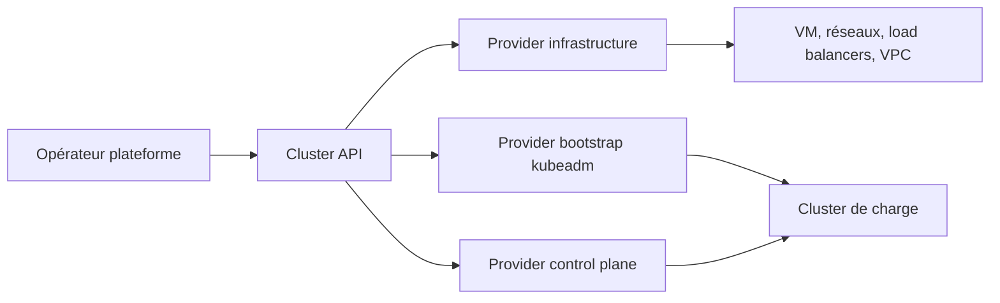

# kubernetes-sigs/cluster-api

> Declarative Kubernetes API to provision, upgrade and operate multiple clusters.

## The problem
Creating and running several Kubernetes clusters is done by hand, differently at each provider.
Nothing guarantees that a cluster reproduced elsewhere is the same.

## What it actually does
A Kubernetes subproject that exposes cluster lifecycle management through Kubernetes-style APIs.
The underlying infrastructure — virtual machines, networks, load balancers, VPCs — is described in the same place.
The cluster configuration is declared the way an operator declares an application deployment.
Extensible through providers: infrastructure (AWS, Azure, vSphere…), bootstrap and control plane, with kubeadm built in.

## How it is wired

## Trying it
No command documented in the README: it points to the Quick Start in the project's book.

## Cost and gotchas
Nothing to pay on the project side, but the infrastructure provisioned at the provider is at your expense.
You need a management cluster and the provider matching your target, installed separately.

## What it is not
Not a single-cluster installer nor a replacement for kubeadm: it orchestrates it.
Not an application layer — nothing about the workloads running in the clusters created.
The README is a front door; all the substance is in the external book.

## Alternatives
No alternative named in the README.

## For you
Relevant only if you operate a fleet of clusters; otherwise it is pure infrastructure plumbing.
