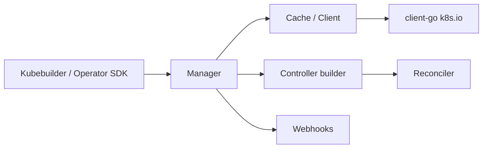

# kubernetes-sigs/controller-runtime

> Go libraries for writing Kubernetes controllers, the foundation of Kubebuilder and the Operator SDK.

## The problem
Writing a controller by hand means rewiring informers, caches, work queues and webhooks.
Aligning the versions of `client-go` and the `k8s.io/*` dependencies is a recurring trap.

## What it actually does
Provides the manager, the controller builder, caches and clients, and the associated designs.
Versioning is explicit: major pinned at zero, one minor version per Kubernetes minor version,
breaking changes allowed between minors, none in patches.
A compatibility table gives, for each minor (CR v0.15 to v0.25), the matching `k8s.io/*` and
`client-go` version and the minimum Go version (1.20 to 1.26).
For contributors, every PR must be labeled `:bug:`, `:sparkles:` or `:warning:`.

## How it is wired

## Trying it
No command documented in the README: it points to the Kubebuilder Quick Start and to the examples.

## Cost and gotchas
Free. `client-go` compatibility outside the tested pairing is "by chance, neither supported nor tested".
The minimum Go version follows that of the `k8s.io/*` dependencies; the truth is in `go.mod`.
Breaking changes arrive between minor versions, so a Kubernetes version upgrade has a cost.

## What it is not
Not a complete framework for starting an operator: the README points to Kubebuilder
and the Operator SDK for new projects. Not stable in the semantic sense: major zero.
Not independent of Go.

## Alternatives
Kubebuilder and the Operator SDK, both cited as better starting points for a new project.

## For you
Good to know from afar: you will meet it as a transitive dependency more than as a direct one.
