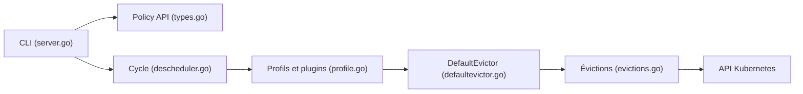

# kubernetes-sigs/descheduler

> Kubernetes component that evicts already-placed pods so the scheduler can place them better; for cluster operators.

## The problem
The scheduler decides once, when the pod is created. Taints, labels, and added or underused nodes later make the placement obsolete.

## What it actually does
According to a `DeschedulerPolicy`, it finds evictable pods and evicts them; it does not schedule the replacements, the default scheduler does. "Deschedule" plugins (affinity violations, taints, restarts, PodLifeTime, failed pods) and "balance" plugins (duplicates, LowNodeUtilization, HighNodeUtilization, topology). A DefaultEvictor protects certain pods (critical ones, DaemonSets, local storage, PDB respected). It exposes metrics and can read Prometheus.

## How it is wired


## Trying it
```bash
kubectl create -f kubernetes/base/rbac.yaml
kubectl create -f kubernetes/base/configmap.yaml
kubectl create -f kubernetes/cronjob/cronjob.yaml
```

## Cost and gotchas
Free, but it runs in `kube-system` with eviction rights. Use the documentation of the release branch matching your version. A badly targeted eviction interrupts workloads (jobs, training runs): PDBs matter.

## What it is not
It is not a scheduler. It does not place anything itself, and by default it relies on pod requests, not actual usage (unless metrics are configured).

## Alternatives
Not documented in the README: no alternative named.

## For you
Relevant if you manage Kubernetes clusters for mixed ML workloads and want to compact or rebalance nodes; otherwise ignore it for pure data science, but be careful about evicted training pods.
