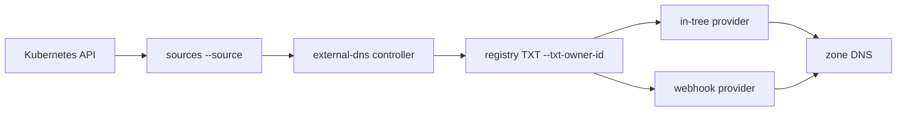

# kubernetes-sigs/external-dns

> Controller that synchronizes Kubernetes Services and Ingresses with an external DNS provider.

## The problem
Manually creating a DNS record for every exposed Service, then fixing it when the load balancer IP changes, does not scale.

## What it actually does
Reads Kubernetes resources (Ingress, Service, Node, Gateway API, DNSEndpoint CRD...) to infer the desired records.
Configures the DNS provider: Route 53, Cloud DNS, AzureDNS, Cloudflare, PowerDNS and about fifteen others in-tree.
Marks what it manages with TXT records (`--txt-owner-id`), which lets it coexist in a non-empty zone.
New providers go through a webhook system: no more in-tree providers are accepted.

## How it is wired


## Trying it
```console
kubectl run nginx --image=nginx --port=80
kubectl expose pod nginx --port=80 --target-port=80 --type=LoadBalancer
kubectl annotate service nginx "external-dns.kubernetes.io/hostname=nginx.example.org."
external-dns --txt-owner-id my-cluster-id --provider google --google-project example-project --source service --once --dry-run
```

## Cost and gotchas
Free, but the DNS provider's API and the zone are on you. Changing `--txt-prefix` loses ownership of records already created. With `--policy=upsert-only` nothing is ever deleted. Third-party webhooks are not reviewed by the maintainers.

## What it is not
Not a DNS server: it configures providers, it resolves nothing. Not backward compatible without reading the compatibility table: v0.10.0, v0.18.0 and v0.19.0 introduce breaking changes. Not a certificate manager.

## Alternatives
Kops' DNS Controller, Zalando's Mate, Molecule Software's route53-kubernetes: the three projects that external-dns unifies, cited in the Heritage section.

## For you
Essential standard as soon as you expose services from Kubernetes, including inference endpoints.
