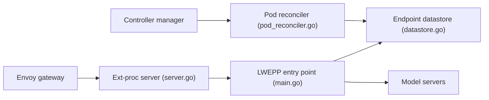

# kubernetes-sigs/gateway-api-inference-extension

> Gateway API extension that turns an Envoy gateway into an inference gateway for self-hosted models.

## The problem
A classic load balancer ignores the KV cache, LoRA adapters and the cost of LLM requests, which degrades latency and throughput.

## What it actually does
Via Envoy's ext-proc, an endpoint picker (EPP) chooses the best model-server replica. This repository now keeps only the InferencePool API, a lightweight reference EPP (LWEPP) and the conformance tests. The main EPP and the body router have moved to llm-d and will be archived here.

## How it is wired


## Trying it
```bash
# Le README renvoie au Getting Started Guide ; aucune commande n'y figure
```

## Cost and gotchas
Free; assumes a cluster with an ext-proc-compatible gateway and GPUs. The main code is moving: read the relocation note carefully before choosing where to build.

## What it is not
No longer the full EPP implementation: only the lightweight one remains here. Not a model server.

## Alternatives
llm-d/llm-d-router (EPP and related APIs) and llm-d/llm-d-inference-payload-processor (BBR), cited in the README.

## For you
Worth watching: a reference for inference routing on Kubernetes, but for production look at llm-d first, where the code is moving.
