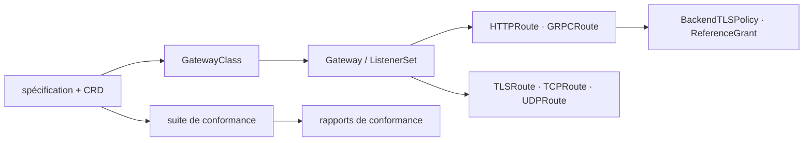

# kubernetes-sigs/gateway-api

> Specification and CRDs of the Kubernetes Gateway API, for controller implementers and operators.

## The problem
Kubernetes Ingress is too limited and each controller adds its own proprietary annotations.
Without verifiable conformance, it is impossible to compare two implementations.

## What it actually does
Contains the specification and the Custom Resource Definitions. Supported version `v1`, published
by release v1.6.1. Resources with GA support: `GatewayClass`, `Gateway`, `ListenerSet`,
`HTTPRoute`, `GRPCRoute`, `TLSRoute`, `TCPRoute`, `UDPRoute`, `BackendTLSPolicy`, `ReferenceGrant`.
Provides a conformance test suite, reports submitted by the implementations,
and a documentation site with concepts, security model and getting-started guides.

## How it is wired

## Trying it
No command documented in the README: it points to the "getting started" guide on the site
to install a first Gateway controller.

## Cost and gotchas
Free. Not all objects are GA: for the other APIs, you must check their support level
in the spec. The license is not declared in the README.

## What it is not
It is not an implementation: there is no controller here, only the API and the tests.
It is not a direct replacement for Ingress without a compatible controller on the other side.
It is not a vendor project: it is part of SIG Network.

## Alternatives
None named; implementations are referred to the conformance reports.

## For you
A reference worth knowing by name if you expose services on Kubernetes; nothing to install here.
