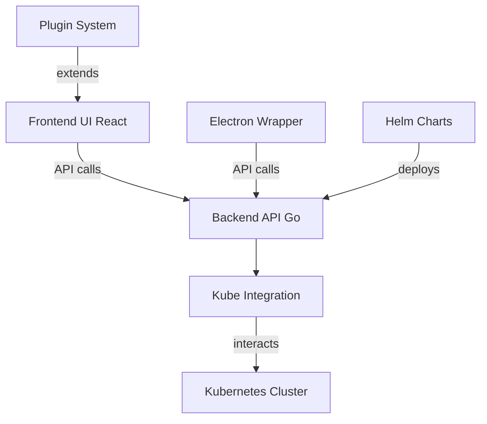

# kubernetes-sigs/headlamp

> Extensible web interface to view and manage a Kubernetes cluster, in-cluster or as a desktop application.

## The problem
Managing Kubernetes resources only from the command line is painful, especially with several clusters and different permissions.

## What it actually does
A React frontend (with Electron for desktop) talks to a Go backend that queries the Kubernetes API with the user's RBAC permissions. It displays resources, logs, a terminal and an editor. Multi-cluster, extensible through plugins.

## How it is wired


## Trying it
```bash
# Le README renvoie à des guides ; seule référence concrète :
# image publiée ghcr.io/headlamp-k8s/headlamp
# Application de bureau : installer le binaire Linux, macOS ou Windows,
# avec un kubeconfig configuré.
```

## Cost and gotchas
Free. The permissions shown depend on the kubeconfig or service account token provided.

## What it is not
Not a monitoring or metrics tool. It shows what your Kubernetes credentials allow you to see, nothing more.

## Alternatives
No alternative named in the README.

## For you
Adopt if you operate ML clusters: lightweight dashboard, RBAC respected, plugins possible, Kubernetes SIGs governance.
