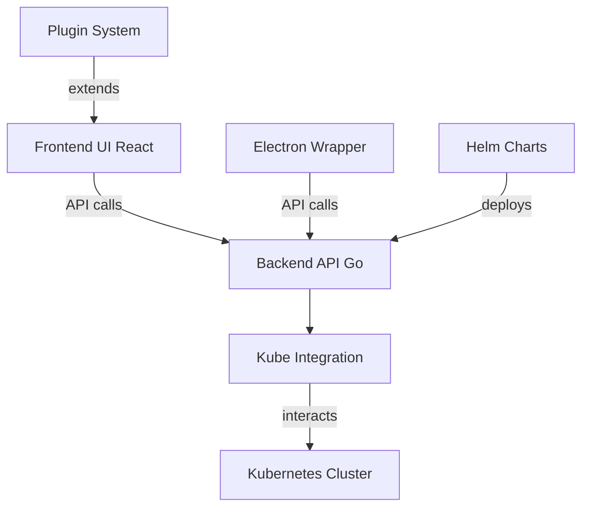

# kubernetes-sigs/headlamp

> Interface web extensible pour consulter et gérer un cluster Kubernetes, en cluster ou en application de bureau.

## Le problème
Gérer des ressources Kubernetes uniquement en ligne de commande est pénible, surtout à plusieurs clusters et avec des droits différents.

## Ce que ça fait vraiment
Un frontend React (avec Electron pour le bureau) parle à un backend Go qui interroge l'API Kubernetes avec les droits RBAC de l'utilisateur. Il affiche ressources, logs, terminal et éditeur. Multi-cluster, extensible par plugins.

## Comment c'est branché


## Essayer
```bash
# Le README renvoie à des guides ; seule référence concrète :
# image publiée ghcr.io/headlamp-k8s/headlamp
# Application de bureau : installer le binaire Linux, macOS ou Windows,
# avec un kubeconfig configuré.
```

## Coût et pièges
Gratuit. Les droits affichés dépendent du kubeconfig ou du token de compte de service fourni.

## Ce que ce n'est pas
Pas un outil de supervision ni de métriques. Il montre ce que tes identifiants Kubernetes permettent de voir, rien de plus.

## Alternatives
Aucune alternative nommée dans le README.

## Pour toi
À adopter si tu opères des clusters ML : tableau de bord léger, RBAC respecté, plugins possibles, gouvernance Kubernetes SIGs.

