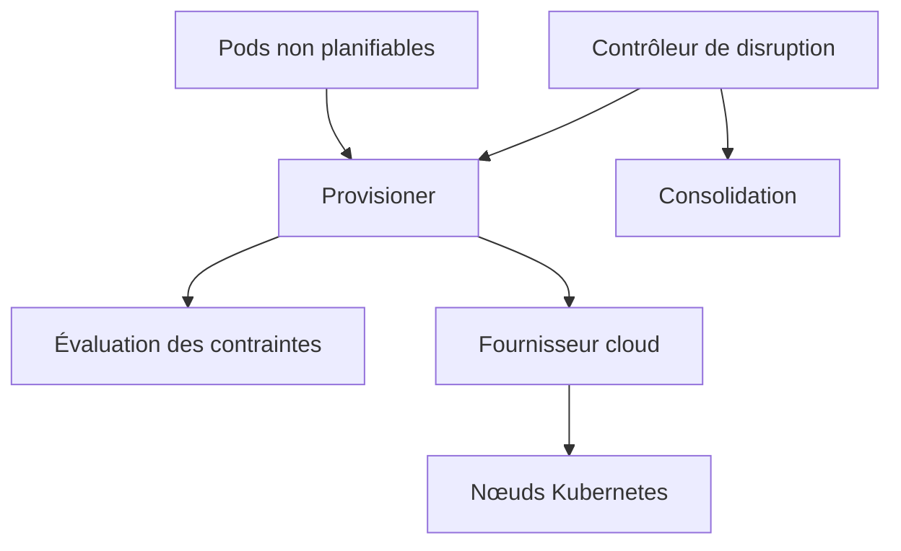

# kubernetes-sigs/karpenter

> A Kubernetes autoscaler that provisions and removes nodes according to the real needs of pods.

## The problem
Static node groups waste capacity or leave pods blocked for lack of suitable nodes, especially for heterogeneous workloads (GPUs, varying size needs).

## What it actually does
Watches unschedulable pods, evaluates their constraints (resources, affinities, tolerations), provisions suitable nodes at the cloud provider, then consolidates or removes nodes that have become useless. Multi-cloud through third-party implementations (AWS, Azure, GCP, Hetzner, OCI, etc.).

## How it is wired

## Trying it
No installation command is documented in the available excerpt: the README points to the implementations specific to each cloud provider.

## Cost and gotchas
Free and open source, but requires an existing Kubernetes cluster and an implementation specific to the chosen cloud provider.

## What it is not
Not a generic cloud-independent autoscaler: the core of the project delegates the actual provisioning to per-provider implementations, to be installed separately. Does not replace the historical Cluster Autoscaler everywhere, depending on the providers.

## Alternatives
The README explicitly cites the "Kubernetes Cluster Autoscaler" as the historical alternative compared in its talks.

## For you
Worth watching for an MLOps person managing Kubernetes clusters with variable load (GPUs included), to reduce training/inference infrastructure costs.
