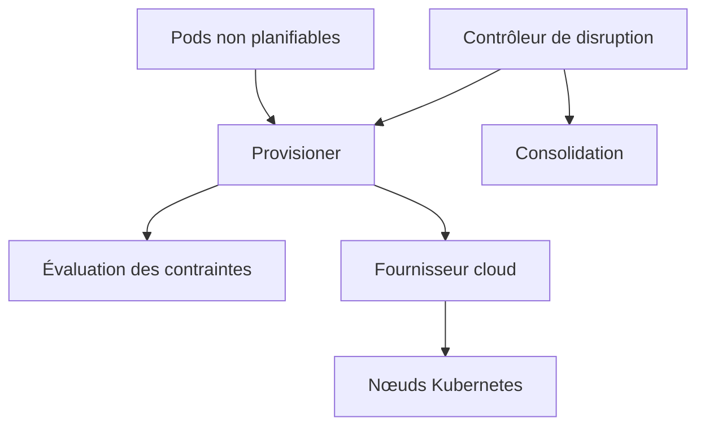

# kubernetes-sigs/karpenter

> Autoscaler Kubernetes qui provisionne et retire des nœuds selon les besoins réels des pods.

## Le problème
Les groupes de nœuds statiques gaspillent de la capacité ou bloquent des pods faute de nœuds adaptés, surtout pour des workloads hétérogènes (GPU, besoins de taille variable).

## Ce que ça fait vraiment
Surveille les pods non planifiables, évalue leurs contraintes (ressources, affinités, tolérances), provisionne des nœuds adaptés chez le fournisseur cloud, puis consolide ou retire les nœuds devenus inutiles. Multi-cloud via des implémentations tierces (AWS, Azure, GCP, Hetzner, OCI, etc.).

## Comment c'est branché

## Essayer
Aucune commande d'installation n'est documentée dans l'extrait disponible : le README renvoie aux implémentations spécifiques par fournisseur cloud.

## Coût et pièges
Gratuit et open-source, mais nécessite un cluster Kubernetes existant et une implémentation spécifique au fournisseur cloud choisi.

## Ce que ce n'est pas
Pas un autoscaler générique indépendant du cloud : le cœur du projet délègue le provisionnement réel à des implémentations par fournisseur, à installer séparément. Ne remplace pas le Cluster Autoscaler historique partout, selon les providers.

## Alternatives
Le README cite explicitement le "Kubernetes Cluster Autoscaler" comme alternative historique comparée dans ses talks.

## Pour toi
À surveiller pour un MLOps qui gère des clusters Kubernetes à charge variable (GPU inclus), afin de réduire les coûts d'infrastructure d'entraînement/inférence.

