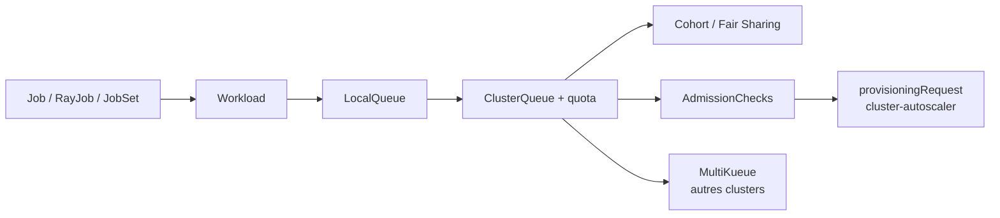

# kubernetes-sigs/kueue

> Kubernetes job queueing controller, for teams sharing GPUs across workloads.

## The problem
Without a job-level manager, pods get admitted in disorder and fight over quota.
Nothing decides when a job should start, stop, or yield its place to a priority job.

## What it actually does
Decides on the admission of a job (creation of pods) and its stopping, with `StrictFIFO` or `BestEffortFIFO` priorities. Advanced resource management: flavor fungibility,
Fair Sharing, cohorts, preemption policies between tenants.
Native integrations: BatchJob, Kubeflow jobs, RayJob, RayCluster, JobSet, Pod and Pod groups.
AdmissionChecks to plug in an external component, integration with the cluster-autoscaler's `provisioningRequest`, all-or-nothing with timeout, partial admission and dynamic quota reclaim,
coexistence of batch and serving, MultiKueue for multi-cluster dispatch, topology-aware scheduling
of the datacenter.

## How it is wired


## Trying it
```bash
kubectl apply --server-side -f https://github.com/kubernetes-sigs/kueue/releases/download/v0.19.5/manifests.yaml
kubectl apply -f examples/admin/single-clusterqueue-setup.yaml
kubectl create -f examples/jobs/sample-job.yaml
```

## Cost and gotchas
Free. Officially tested and supported on Kubernetes 1.34 or newer; the controller runs
in the `kueue-system` namespace. API in `v1beta2`: still evolving, even though the project follows
the Kubernetes deprecation policy and ships every 2-3 months.

## What it is not
It is not a pod scheduler: it decides on job admission, then `kube-scheduler` places them.
It is not a workflow manager: no dependencies between steps.
It is not an autoscaler, it integrates with one.

## Alternatives
None named; KueueViz is cited as the project's visualization.

## For you
The right tool if you share a GPU fleet across training runs: the per-ClusterQueue quota settles conflicts.
