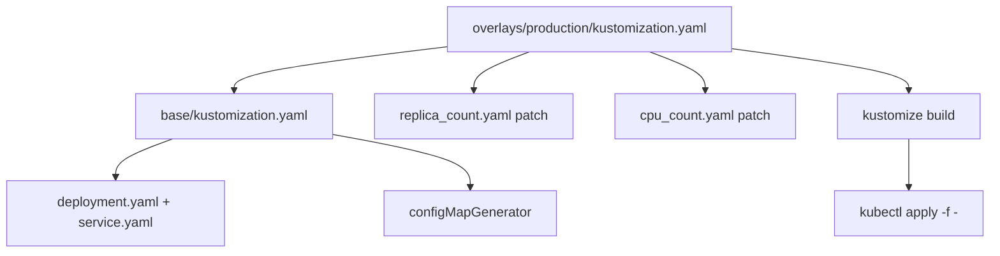

# kubernetes-sigs/kustomize

> Template-free customization of Kubernetes YAML through bases and overlays, for any kubectl user.

## The problem
Rolling out the same deployment across dev, staging and production pushes you either to duplicate the YAML or to templatize it.
Either way, picking up upstream improvements becomes painful.

## What it actually does
A `kustomization.yaml` file declares `resources` and the customizations to apply to them: common labels, `configMapGenerator`, patches.
`kustomize build` emits the final YAML without touching the original files, ready for `kubectl apply -f -`.
Variants are built with overlays: an `overlays/production` folder references `../../base` and lists its patches (`replica_count.yaml`, `cpu_count.yaml`).
Since the resources are never modified, a fork can rebase on upstream.

## How it is wired


## Trying it
```sh
kubectl version --client
kustomize build ~/someApp
kustomize build ~/someApp | kubectl apply -f -
kustomize build ~/someApp/overlays/production
```

## Cost and gotchas
Free; the binary is already embedded in `kubectl`, but at an older version — the README table shows the gap (kubectl v1.27 → kustomize v5.0.1).
Classic gotcha: the `kustomize` inside `kubectl` and the standalone binary do not behave the same depending on versions.

## What it is not
Not a template engine: there are no variables or conditions; the README compares it to `sed` as a declarative text editor.
Not a release manager: no notion of history or rollback, unlike Helm.
Not an apply tool: it emits YAML, `kubectl` does the rest.

## Alternatives
- make: comparison claimed in the README for its declarative side, not a real substitute.
- kubectl: includes the `kustomize build` flow if you do not need the latest version.

## For you
Useful whenever you deploy an ML service on Kubernetes across several environments without wanting Helm.
