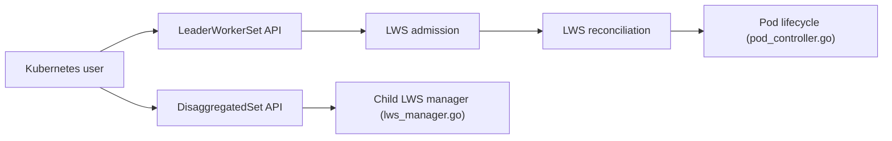

# kubernetes-sigs/lws

> Kubernetes API for deploying a group of pods as a single unit, for multi-node inference.

## The problem
Serving an LLM split across several nodes requires the leader and workers to be created, updated and restarted together.

## What it actually does
LeaderWorkerSet: a leader plus workers group forms one replica, with per-index identity, parallel creation, topology-aware placement, all-or-nothing scheduling (alpha), per-group updates and a full restart on failure. DisaggregatedSet manages several roles (e.g. prefill and decode) in lockstep. Webhooks validate and complete the resources.

## How it is wired


## Trying it
```bash
# Le README renvoie au guide d'installation et aux exemples ; aucune commande n'y figure
```

## Cost and gotchas
Free, but it only pays off with a cluster that has accelerators. Gang scheduling is in alpha and the API may change. Compatible with TPUs according to the code.

## What it is not
Not an inference server: it is the deployment plane. You need a model server on top.

## Alternatives
No alternative named in the README (co-designed with llm-d).

## For you
Adopt it if you serve large multi-node models on Kubernetes: standard API from an official subproject, recent activity.
