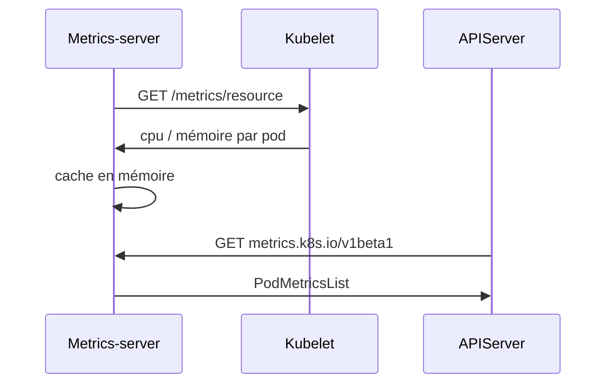

# kubernetes-sigs/metrics-server

> Scalable source of CPU/memory metrics for Kubernetes' built-in autoscaling.

## The problem
HPA/VPA and `kubectl top` need fresh resource metrics per node and pod. Without a dedicated source, autoscaling has no signal.

## What it actually does
Collects resource metrics from the Kubelets and exposes them through the apiserver's Metrics API, for HPA, VPA and `kubectl top`. A single deployment, collection every 15 s, ~1 millicore CPU and 2 MB per node, up to 5,000 nodes. Installation via YAML manifest or Helm chart, high-availability mode.

## How it is wired


## Trying it
```shell
kubectl apply -f https://github.com/kubernetes-sigs/metrics-server/releases/latest/download/components.yaml
```

## Cost and gotchas
Free. Requires the aggregation layer enabled, node webhook auth, a Kubelet certificate signed by the cluster CA (or `--kubelet-insecure-tls` for tests). The `CAP_NET_BIND_SERVICE` capability is required.

## What it is not
**Only for autoscaling**: not a monitoring solution, nor an accurate source of metrics. For that, Prometheus.

## Alternatives
- Prometheus: full monitoring, when you need more than autoscaling.
- kubernetes/kube-state-metrics: object state metrics (complementary).

## For you
Standard infrastructure building block; relevant only if you run ML workloads on Kubernetes with autoscaling.
