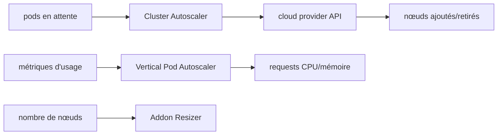

# kubernetes/autoscaler

> Monolithic repository of Kubernetes autoscaling components: cluster, vertical pods, addons.

## The problem
Without autoscaling, a cluster keeps useless nodes or leaves pods without room, and CPU/memory requests remain guessed by hand.

## What it actually does
Cluster Autoscaler adjusts the cluster size so that all pods have a place and no node is useless; GA since Kubernetes 1.8, several public clouds supported.
Vertical Pod Autoscaler automatically adjusts the CPU and memory requests of pods; beta status.
Addon Resizer, a simplified version of VPA, modifies a deployment's requests according to the number of nodes; beta status.
Each of the two autoscalers has a supported Helm chart.

## How it is wired


## Trying it
```shell
mkdir -p $GOPATH/src/k8s.io
cd $GOPATH/src/k8s.io
git clone https://github.com/$YOUR_GITHUB_USERNAME/autoscaler.git
cd autoscaler
```

## Cost and gotchas
Free. The code must absolutely be cloned under `k8s.io` and not `github.com`, otherwise the build fails. The README documents no installation command: you have to go through the Helm charts or the docs of each sub-component.

## What it is not
Not a single product: three distinct components, at different maturities (GA for the Cluster Autoscaler, beta for VPA and Addon Resizer). No horizontal pod autoscaling here, that is the HPA of Kubernetes core. The README is an index, the substance is in the subdirectories.

## Alternatives
No alternative named in the README.

## For you
The Cluster Autoscaler is the building block to know if you run training jobs with variable load on Kubernetes.
