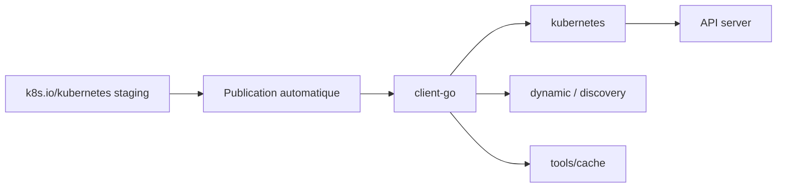

# kubernetes/client-go

> Official Go clients for talking to the Kubernetes API, published automatically from the main repository.

## The problem
Writing a controller or a tool that talks to the Kubernetes API over raw HTTP means reimplementing
typing, API discovery, authentication and object caching.

## What it actually does
Provides the `kubernetes` package (typed clientset), `discovery` (discovery of the APIs supported by a server),
`dynamic` (generic operations on arbitrary objects), `plugin/pkg/client/auth` (external
authentication plugins), `transport` (auth and connection) and `tools/cache`, the foundation for writing
controllers. Versioning: major frozen at `0`, one branch and one tag per Kubernetes minor version,
plus `kubernetes-1.x.y` tags mirroring the main repository.

## How it is wired


## Trying it
```bash
go get k8s.io/client-go@latest
go get k8s.io/client-go@v0.20.4
```

## Cost and gotchas
Free. Go 1.16 or later for `@latest`. The `v0.x.y` tags signal that the Go APIs **may
change in incompatible ways** from one version to the next; the Kubernetes version tag guarantees
no backward compatibility. Branches prior to `release-1.31` are deprecated or in
limited manual maintenance for serious vulnerabilities only.

## What it is not
Not a contribution repository: it is read-only, issues and PRs go to `kubernetes/kubernetes`.
Not a controller framework: `tools/cache` is a building block, not a complete scaffold.
No license stated in this README.

## Alternatives
No alternative repository is named in the README.

## For you
The obligatory route if you write a Go operator; otherwise `kubectl` is enough.
