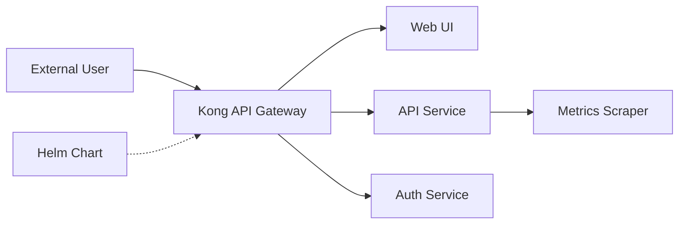

# kubernetes/dashboard

> General-purpose web interface for managing and troubleshooting a Kubernetes cluster; the README announces archiving.

## The problem
See and administer cluster resources without doing everything on the command line.

## What it actually does
Deployment only via Helm since version 7: several containers (Go API, Auth, metrics-scraper, Angular Web) behind a Kong gateway. The README states at the top that the project is archived for lack of maintainers and recommends Headlamp.

## How it is wired


## Trying it
```bash
helm repo add kubernetes-dashboard https://kubernetes.github.io/dashboard/
helm upgrade --install kubernetes-dashboard kubernetes-dashboard/kubernetes-dashboard --create-namespace --namespace kubernetes-dashboard
```

## Cost and gotchas
Contradiction: the README talks about archiving while the catalog says "archived: no". A cluster and Helm are required. No more manifest-based installation support.

## What it is not
Not maintained according to its own README; not an ML tracking tool.

## Alternatives
- Headlamp: recommended by the README, now under sig-ui.

## For you
Ignore it: the README announces the end of maintenance; go with Headlamp for a Kubernetes UI.
