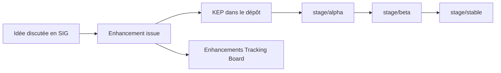

# kubernetes/enhancements

> Tracking repository for Kubernetes evolutions: umbrella issues and one KEP per feature.

## The problem
A Kubernetes evolution spans several releases and several SIGs.
Without a common registry, nobody can check that tests, docs and reviews have kept up.

## What it actually does
Hosts the tracking issues and the KEPs; owned by SIG Architecture.
Gives the heuristics to know whether a change is an "enhancement" — and when it is not.
Defines when to open an issue: idea already discussed, people identified, availability of nine months to a year.
Three stages Alpha, Beta, Stable, with a checklist and different approvers per aspect.

## How it is wired

## Trying it
No command documented: it is a process repository, not software.

## Cost and gotchas
Free. The real cost is human: nine months to a year of commitment to carry an evolution through to Stable.
Design comments do not go on the tracking issue but on a dedicated issue or PR.

## What it is not
Not code: no implementation here.
Not a product roadmap — what is listed is not guaranteed to ship.
Not a place for technical design debate.

## Alternatives
No alternative named in the README.

## For you
Of no direct interest for a data role; open only to anticipate a Kubernetes API that is changing.
