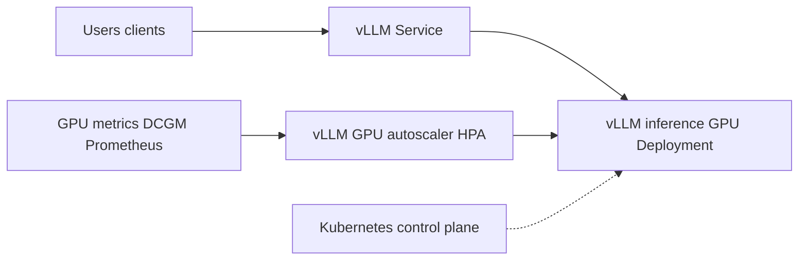

# kubernetes/examples

> Official collection of example Kubernetes manifests, including AI model serving, maintained by SIG Apps.

## The problem
Writing Kubernetes manifests for an AI application or workload from scratch is slow, and best practices are scattered.

## What it actually does
A repository of manifests, not an application. On the AI side: TensorFlow Serving (Deployment, Service, persistent volume) and vLLM on GPU with autoscaling (HPA) fed by DCGM and Prometheus metrics. On the web side: a guestbook with Redis. On the database side: Cassandra as a StatefulSet, MySQL on persistent disk. An `_archived/` folder keeps the old examples.

## How it is wired

## Trying it
No command in the main README: each example has its own `README.md` with deployment, verification and cleanup.

## Cost and gotchas
Free, but you need a Kubernetes cluster. The GPU examples assume GPU nodes, DCGM, Prometheus, and sometimes GKE-specific variants.

## What it is not
Not a ready-to-use MLOps platform: these are teaching examples, sometimes simplified. The archived material does not represent current practices.

## Alternatives
No alternative named in the README.

## For you
Worth watching: a good starting point for deploying vLLM or TensorFlow Serving with GPU autoscaling, to be adapted before any serious use.
