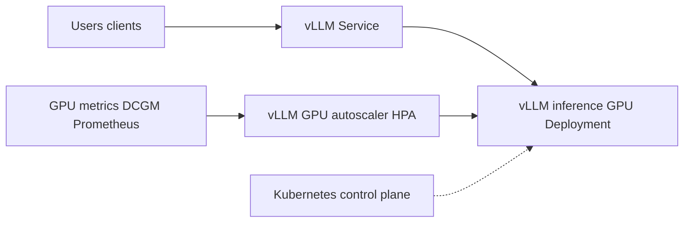

# kubernetes/examples

> Collection officielle d'exemples de manifestes Kubernetes, dont du service de modèles IA, tenue par SIG Apps.

## Le problème
Écrire des manifestes Kubernetes pour une application ou une charge d'IA à partir de zéro est long, et les bonnes pratiques sont dispersées.

## Ce que ça fait vraiment
Un dépôt de manifestes, pas une application. Côté IA : TensorFlow Serving (Deployment, Service, volume persistant) et vLLM sur GPU avec autoscaling (HPA) alimenté par les métriques DCGM et Prometheus. Côté web : guestbook avec Redis. Côté bases : Cassandra en StatefulSet, MySQL sur disque persistant. Un dossier `_archived/` garde les anciens exemples.

## Comment c'est branché

## Essayer
Aucune commande dans le README principal : chaque exemple a son propre `README.md` avec déploiement, vérification et nettoyage.

## Coût et pièges
Gratuit, mais il faut un cluster Kubernetes. Les exemples GPU supposent des nœuds GPU, DCGM, Prometheus, et parfois des variantes propres à GKE.

## Ce que ce n'est pas
Pas une plateforme MLOps prête à l'emploi : ce sont des exemples pédagogiques, parfois simplifiés. Le matériel archivé ne représente pas les pratiques actuelles.

## Alternatives
Aucune alternative nommée dans le README.

## Pour toi
À surveiller : bon point de départ pour déployer vLLM ou TensorFlow Serving avec autoscaling GPU, à adapter avant tout usage sérieux.

