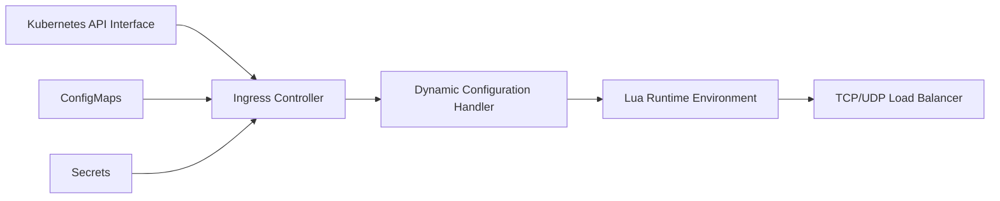

# kubernetes/ingress-nginx

> NGINX-based Kubernetes Ingress controller, retired and archived since March 2026.

## The problem
Exposing services from a Kubernetes cluster to the outside requires a reverse proxy that dynamically follows Ingress objects, certificates and services.

## What it actually does
The controller watches the Kubernetes API (Ingress, ConfigMaps, Secrets) and reconfigures NGINX accordingly.
NGINX serves as reverse proxy and load balancer, with Lua modules for dynamic configuration.
Admission webhook, metrics, TCP/UDP (architecture).
No more releases, fixes or security updates after March 2026.

## How it is wired

## Trying it
No command documented in the README, which now contains only the retirement notice.

## Cost and gotchas
Free, but future vulnerabilities will go unpatched. Images and Helm charts remain available, which can be misleading.

## What it is not
Not suited to multi-tenant clusters: it assumes whoever creates an Ingress is an administrator. No longer a choice for a new deployment.

## Alternatives
- A Gateway API implementation: explicit recommendation of the README.

## For you
Ignore: archived repository; if your inference clusters still use it, plan the migration to Gateway API.
