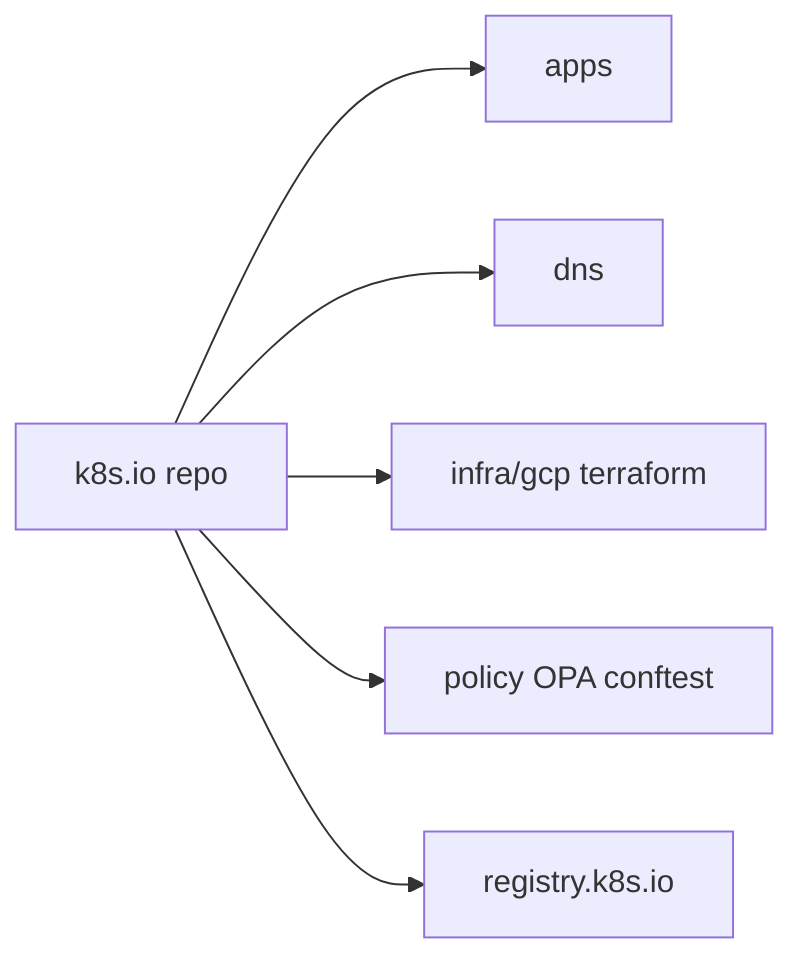

# kubernetes/k8s.io

> Repository of the Kubernetes project's infrastructure, managed by sig-k8s-infra, for community maintainers.

## The problem
A project of this size needs infrastructure (DNS, registries, groups, cloud accounts) managed as code, auditable and reviewed in public.

## What it actually does
Gathers the code and data of the community infrastructure: applications (codesearch, gcsweb, perfdash, publishing-bot, slack-infra...), DNS for kubernetes.io and k8s.io, Google groups, GCP scripts, Terraform modules, OPA policies validated by conftest and work on registry.k8s.io.

## How it is wired


## Trying it
```bash
# Aucune commande documentée dans l'extrait du README :
# les détails sont renvoyés vers des pages liées.
```

## Cost and gotchas
Not designed for external use: the scripts assume the project's GCP accounts. The billing report is visible only to members of the sig-k8s-infra list.

## What it is not
Not Kubernetes itself nor a reusable tool: it is the community's internal infrastructure.

## Alternatives
No alternative named in the README.

## For you
Ignore: useful only as an example of Terraform and OPA infrastructure to read, not as a tool to adopt.
