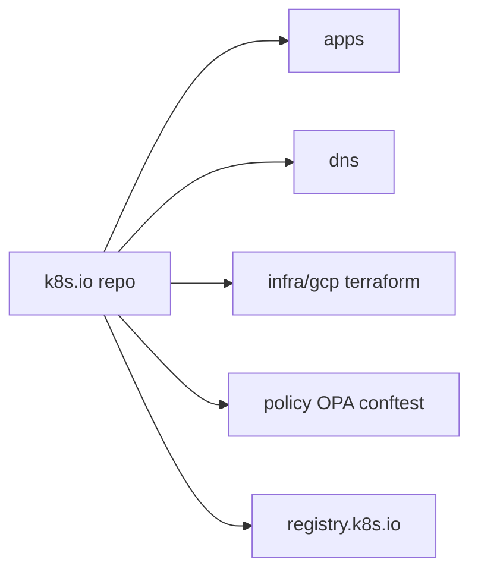

# kubernetes/k8s.io

> Dépôt de l'infrastructure du projet Kubernetes, géré par sig-k8s-infra, pour les mainteneurs de la communauté.

## Le problème
Un projet de cette taille a besoin d'une infrastructure (DNS, registres, groupes, comptes cloud) gérée en code, auditable et revue en public.

## Ce que ça fait vraiment
Regroupe le code et les données de l'infra communautaire : applications (codesearch, gcsweb, perfdash, publishing-bot, slack-infra...), DNS de kubernetes.io et k8s.io, groupes Google, scripts GCP, modules Terraform, politiques OPA validées par conftest et travail sur registry.k8s.io.

## Comment c'est branché


## Essayer
```bash
# Aucune commande documentée dans l'extrait du README :
# les détails sont renvoyés vers des pages liées.
```

## Coût et pièges
Pas conçu pour un usage externe : les scripts supposent les comptes GCP du projet. Le rapport de facturation n'est visible que des membres de la liste sig-k8s-infra.

## Ce que ce n'est pas
Pas Kubernetes lui-même ni un outil réutilisable : c'est l'infra interne de la communauté.

## Alternatives
Aucune alternative nommée dans le README.

## Pour toi
Ignorer : utile seulement comme exemple d'infra Terraform et OPA à lire, pas comme outil à adopter.

