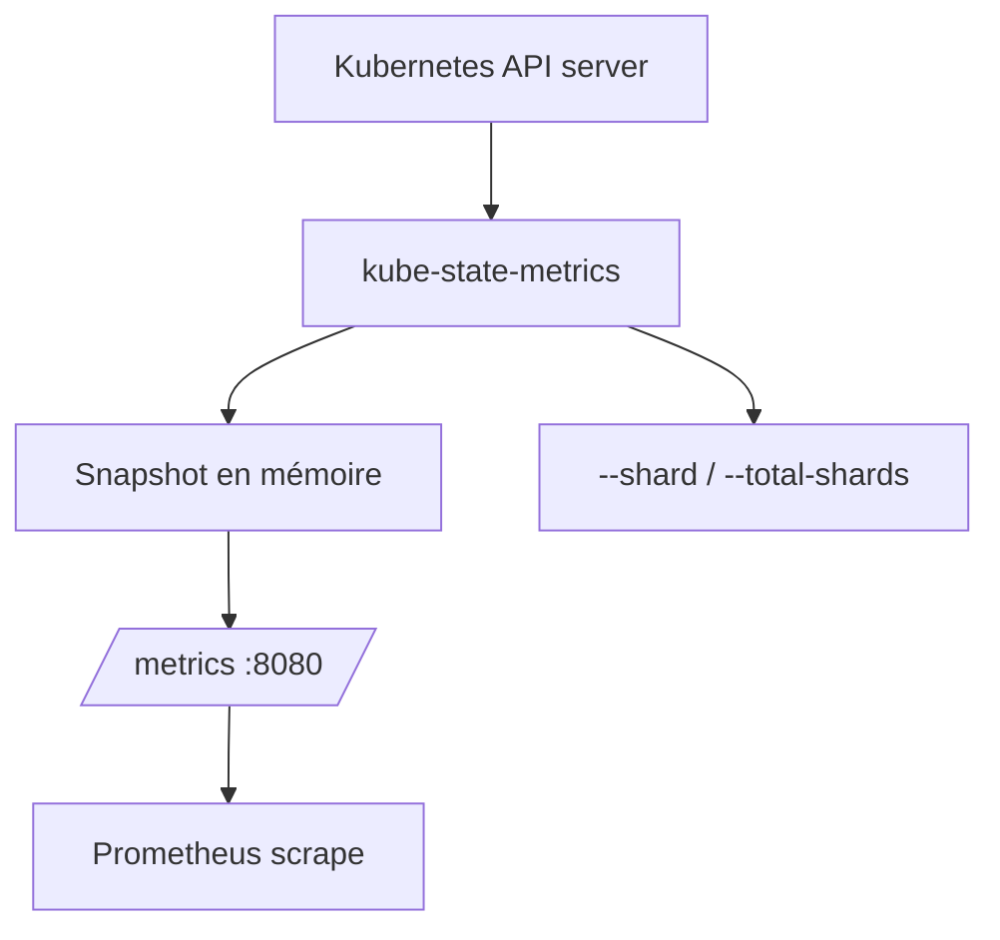

# kubernetes/kube-state-metrics

> Service that listens to the Kubernetes API and generates Prometheus metrics about the state of objects.

## The problem
You want metrics about the state of Kubernetes objects (deployments, nodes, pods) in Prometheus format, without kubectl hiding the raw data behind heuristics.

## What it actually does
Listens to the apiserver and generates metrics about the state of objects, unmodified (same stability as the API itself). Exposed as text on `/metrics` (port 8080), consumable by Prometheus. They reflect the current state: deleted objects disappear. Horizontal sharding (by md5 of the UID), automatic (StatefulSet) or per Deployment, and per-node sharding for pod metrics (DaemonSet). Filtering by resource type through query params.

## How it is wired


## Trying it
```bash
kubectl apply -f examples/standard
```
```bash
curl 'http://localhost:8080/metrics?resources=pods,secrets'
```

## Cost and gotchas
Free. ~250 MiB / 0.1 core baseline; usage grows with cluster size. Can ingest a lot of data (cloud costs) on events — configure the exposed metrics. On GKE, RBAC rights must be adjusted.

## What it is not
Not metrics-server: it does not serve autoscaling or live CPU/memory resource metrics, but the state of objects. It does not itself export to any destination.

## Alternatives
- kubernetes-sigs/metrics-server: resource metrics for autoscaling (complementary).
- prometheus-operator/kube-prometheus: already installs it as a component.

## For you
Standard K8s monitoring building block; useful if you observe ML workloads on Kubernetes through Prometheus.
